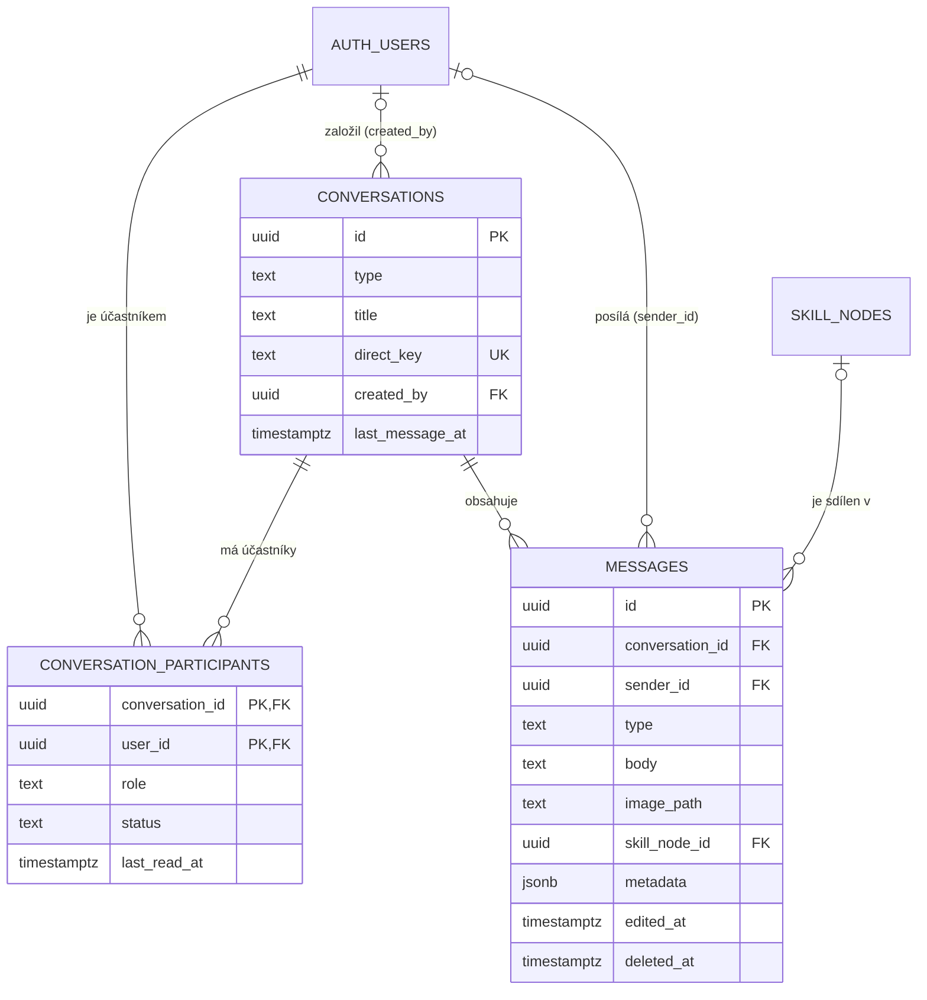

# 01 – Chat: datový návrh v Supabase

## 1. Co bylo uděláno

Navrhl jsem a napsal databázovou část komunikačního modulu: tabulky pro konverzace (1:1 i skupinové), jejich účastníky a zprávy (text, obrázek, sdílený skill, systémová zpráva). Bezpečnost řeší RLS pravidla, která zaručují, že zprávy vidí jen přijatí členové konverzace. Návrh rovnou počítá s úpravou a mazáním zpráv, správou skupin (role owner/admin/member) a žádostmi o chat, které musí příjemce nejdřív přijmout.

## 2. Nové a změněné soubory

| Soubor | K čemu slouží |
|---|---|
| `supabase/migrations/20261011001_chat.sql` | Migrace: tabulky, indexy, RLS politiky, práva na sloupce, triggery, RPC funkce, storage bucket `chat-media`, Realtime |
| `supabase/tests/chat_rls_checks.sql` | Ruční testy RLS: bloky SQL, které se za různé uživatele pokusí udělat povolené i zakázané věci |
| `docs/database.md` | Doplněna sekce 9 „Chat“ (tabulky, bucket, RPC, ER přehled) |
| `.gitignore` | Přidáno `docs/learning/`, aby se tyto učební zápisy necommitovaly |
| `docs/learning/01-chat-datovy-navrh.md` | Tento zápis |

## 3. Tabulky a jak spolu souvisí

### `conversations`: jedna konverzace

| Sloupec | Typ | Význam |
|---|---|---|
| `id` | uuid PK | identifikátor konverzace |
| `type` | text | `direct` (1:1) nebo `group` (skupina) |
| `title` | text | název, **jen u skupiny** (1–100 znaků). U `direct` musí být NULL |
| `direct_key` | text UNIQUE | jen u 1:1, např. `"aaa…:bbb…"` (menší UUID : větší UUID). Díky UNIQUE nemůžou mezi dvěma lidmi vzniknout dvě konverzace |
| `created_by` | uuid → auth.users | kdo konverzaci založil (po smazání účtu NULL) |
| `last_message_at` | timestamptz | čas poslední zprávy, podle něj se řadí seznam chatů. Nastavuje ho trigger |
| `created_at`, `updated_at` | timestamptz | časy vytvoření a poslední změny |

### `conversation_participants`: kdo je v konverzaci

| Sloupec | Typ | Význam |
|---|---|---|
| `conversation_id` | uuid → conversations | část primárního klíče |
| `user_id` | uuid → auth.users | část primárního klíče |
| `role` | text | `owner` (vlastník), `admin`, `member` (u 1:1 vždy `member`) |
| `status` | text | `pending` = žádost ještě nepřijata, `accepted` = přijato |
| `joined_at` | timestamptz | kdy byl přidán nebo kdy přijal |
| `last_read_at` | timestamptz | kdy si naposledy přečetl konverzaci (pro „nepřečtené“) |

Primární klíč `(conversation_id, user_id)` zajišťuje, že jeden člověk je v jedné konverzaci nejvýš jednou.

### `messages`: zprávy

| Sloupec | Typ | Význam |
|---|---|---|
| `id` | uuid PK | |
| `conversation_id` | uuid → conversations | do které konverzace zpráva patří |
| `sender_id` | uuid → auth.users | autor. NULL u systémových zpráv a po smazání účtu autora |
| `type` | text | `text`, `image`, `skill`, `system` |
| `body` | text | text zprávy, popisek obrázku nebo komentář ke skillu (max 4000 znaků) |
| `image_path` | text | cesta k obrázku v bucketu `chat-media` |
| `skill_node_id` | uuid → skill_nodes | sdílený skill |
| `metadata` | jsonb | jen u systémových zpráv, např. `{"event":"member_added","actor_id":…,"target_id":…}` |
| `created_at` | timestamptz | čas odeslání |
| `edited_at` | timestamptz | NULL = neupraveno, jinak čas poslední úpravy |
| `deleted_at` | timestamptz | NULL = nesmazáno, jinak čas smazání (obsah je vymazán) |

**CHECK pravidla na `messages`:**
- `text` musí mít neprázdné `body`
- `image` musí mít `image_path`
- `system` musí mít `metadata`
- smazaná zpráva nesmí mít žádný obsah

### Vztahy

- Jeden uživatel může být v mnoha konverzacích a jedna konverzace má mnoho uživatelů. Jde o vztah **M:N**, a ten se řeší spojovací tabulkou `conversation_participants`.
- Jedna konverzace má mnoho zpráv (**1:N**).
- Zpráva může odkazovat na jeden skill (**N:1**, nepovinně).



### Co se stane při mazání (ON DELETE)

| Co se smaže | Co se stane |
|---|---|
| konverzace | smažou se i její účastníci a zprávy (`CASCADE`) |
| účet uživatele | zmizí jeho účast (`CASCADE`), jeho zprávy zůstanou s `sender_id = NULL` (`SET NULL`) |
| skill | zprávy zůstanou, `skill_node_id = NULL` a UI ukáže „skill už neexistuje“ |

## 4. Jak to funguje krok po kroku

### A) Martin napíše Petrovi poprvé (1:1)

1. Frontend zavolá `get_or_create_direct_conversation(petr_id)`.
2. Funkce sestaví `direct_key` (seřazená UUID obou lidí) a podívá se, jestli taková konverzace existuje. Pokud ano, vrátí ji a končí.
3. Pokud ne, vloží řádek do `conversations` (`type = 'direct'`).
4. Vloží dva řádky do `conversation_participants`:
   - Martin: `status = 'accepted'`
   - Petr: `status = 'pending'` (to je ta žádost o chat)
5. Martin pošle zprávu: `INSERT INTO messages (conversation_id, type, body)`.
   - RLS zkontroluje, že `sender_id` je Martin a že je `accepted` členem.
   - Trigger `before insert` zkontroluje typ (u skillu, že je vyplněný skill; u obrázku, že cesta sedí).
   - Trigger `after insert` nastaví `conversations.last_message_at`.
6. Petr vidí v seznamu konverzaci (RLS: je *účastník*), ale **zprávy ne** (RLS: není *přijatý člen*).
7. Petr zavolá `accept_conversation(id)`, jeho `status` se změní na `accepted`, a teprve teď zprávy uvidí.
   - Pokud zavolá `decline_conversation(id)`, celá 1:1 konverzace se smaže.

### B) Skupina

1. `create_group_conversation('Kytaristi', [petr, jana])`: tvůrce je `owner` + `accepted`, pozvaní jsou `member` + `pending`. Vloží se systémová zpráva `group_created`.
2. Přejmenování: `rename_conversation`, smí owner nebo admin.
3. Přidání: `add_conversation_members`, smí owner nebo admin, přidaní jsou `pending`.
4. Odebrání: `remove_conversation_member`. Admin smí odebrat jen membera, owner kohokoli.
5. Změna role: `set_participant_role`, jen owner. Nastavení `owner` předá vlastnictví a starý owner se stane adminem.
6. Odchod: `leave_conversation`. Smaže se řádek účastníka a trigger pak:
   - odešel owner → vlastníkem se stane nejstarší admin, jinak nejstarší člen
   - nezůstal nikdo přijatý → konverzace se smaže i se zprávami

### C) Úprava a smazání zprávy

- **Úprava:** `UPDATE messages SET body = '…'`. Smí jen autor (RLS) a jen sloupec `body` (práva na sloupce). Trigger sám nastaví `edited_at = now()`.
- **Smazání:** `delete_message(id)`. Nastaví `deleted_at` a vymaže `body`, `image_path` a `skill_node_id`. Řádek zůstane, takže UI může ukázat „Zpráva byla smazána“. Funkce vrátí starou cestu k obrázku a frontend pak soubor smaže přes Storage API.

### D) Obrázek

1. Frontend nahraje soubor do bucketu `chat-media` na cestu `{conversation_id}/{moje_id}/{nazev}`. Storage politika ověří, že jsem členem a nahrávám do své složky.
2. Pošle zprávu `type = 'image'`, `image_path = tu cestu`.
3. Ostatní členové si vygenerují dočasný odkaz (`createSignedUrl`). Bucket je **soukromý**, takže obrázek nikdo cizí neotevře.

## 5. RLS pro začátečníka

### Co to je
**Row Level Security** = zabezpečení na úrovni řádků. U tabulky se zapne příkazem `ENABLE ROW LEVEL SECURITY`, a od té chvíle databáze **standardně nevrátí nic**. Uživatel uvidí nebo změní jen řádky, které povolí nějaká **policy** (pravidlo).

### Proč to potřebuju
Frontend SkillCatch mluví s databází napřímo přes `supabase-js` a veřejný `anon` klíč. Ten klíč je vidět v prohlížeči, takže si kdokoli může napsat vlastní dotaz, třeba „dej mi všechny zprávy“. Kontrola ve frontendu proto nestačí, protože ji jde obejít. RLS běží **v databázi** a obejít nejde.

### Klíčové slovo `USING` vs `WITH CHECK`
- `USING (…)`: které **existující** řádky smím vidět, upravit nebo smazat
- `WITH CHECK (…)`: jak smí vypadat řádek, který **vkládám** nebo **ukládám po úpravě**

### Každé pravidlo zvlášť

| Policy | Tabulka | Co dělá |
|---|---|---|
| `conversations_select_participant` | conversations | konverzaci vidím, když jsem v ní (i jako `pending`, abych viděl žádost) |
| `participants_select_participant` | conversation_participants | vidím seznam lidí v konverzacích, kde jsem |
| `messages_select_member` | messages | zprávy čtu jen jako **přijatý** člen |
| `messages_insert_member` | messages | zprávu pošlu jen sám za sebe (`sender_id = já`), jen jako přijatý člen a nikdy typ `system` |
| `messages_update_own` | messages | upravím jen svou, nesmazanou, nesystémovou zprávu, a jen když jsem pořád člen |
| *(žádná INSERT/UPDATE/DELETE policy)* | conversations, participants | napřímo nejde zapsat nic, všechno jde přes RPC funkce, které kontrolují role |
| *(žádná DELETE policy)* | messages | mazání jen přes `delete_message()` (měkké mazání) |
| `chat-media member read` | storage | obrázek otevře jen člen konverzace (podle 1. složky cesty) |
| `chat-media member insert` | storage | nahrát smí člen, a jen do své podsložky (2. složka = moje id) |
| `chat-media owner delete` | storage | smazat smí jen autor souboru |

### Problém s rekurzí a jak je vyřešený
Naivní pravidlo „vidím účastníky konverzací, ve kterých jsem“ by vypadalo takhle:
```sql
USING (conversation_id IN (
  SELECT conversation_id FROM conversation_participants WHERE user_id = auth.uid()
))
```
Poddotaz čte **stejnou tabulku**, takže se na něj zase uplatní stejné pravidlo, a to zase spustí poddotaz… Postgres skončí chybou `infinite recursion detected in policy`.

**Řešení:** pomocné funkce `is_conversation_participant(id)` a `is_conversation_member(id)` se `SECURITY DEFINER`. Běží s právy vlastníka tabulky, na kterého RLS nepůsobí, takže se prostě podívají do tabulky a vrátí true/false bez rekurze. Uvnitř vždy porovnávají s `auth.uid()`, takže se přes ně nedá zjistit nic o jiných lidech.

### Druhá vrstva: práva na sloupce
RLS hlídá **řádky**, ne **sloupce**. Pravidlo „smíš upravit svou zprávu“ by samo o sobě dovolilo změnit i `created_at` nebo `conversation_id`. Proto:
```sql
REVOKE UPDATE ON messages FROM authenticated;
GRANT UPDATE (body) ON messages TO authenticated;
```
Uživatel teď smí měnit jen `body`. Podobně u INSERT nesmí vyplnit `created_at`, `edited_at`, `deleted_at` ani `metadata`.

## 6. Nové pojmy

| Pojem | Jednoduše |
|---|---|
| **Primární klíč (PK)** | sloupec (nebo dvojice sloupců), který jednoznačně určuje řádek. Nesmí se opakovat ani být NULL |
| **Cizí klíč (FK)** | sloupec, který odkazuje na řádek v jiné tabulce. Databáze nedovolí odkaz na neexistující řádek |
| **ON DELETE CASCADE / SET NULL** | co se stane s odkazujícími řádky, když se smaže ten odkazovaný: smazat taky / vynulovat odkaz |
| **UNIQUE** | hodnota se v tabulce nesmí opakovat (`direct_key`) |
| **CHECK** | podmínka, kterou musí splnit každý řádek (např. `type IN ('text','image',…)`). Pozor: výsledek NULL se bere jako „prošlo“ |
| **Index** | pomocná seřazená struktura (jako rejstřík v knize), díky které databáze najde řádky rychle bez procházení celé tabulky |
| **RLS** | Row Level Security, pravidla určující, které řádky smí uživatel vidět a měnit |
| **Policy** | jedno konkrétní RLS pravidlo pro určitou operaci (SELECT/INSERT/UPDATE/DELETE) |
| **`auth.uid()`** | funkce Supabase, která vrátí id právě přihlášeného uživatele (z JWT tokenu) |
| **Role `authenticated` / `anon`** | databázové role, pod kterými běží dotazy přihlášeného a nepřihlášeného uživatele |
| **GRANT / REVOKE** | přidělení / odebrání práva (např. smět spustit funkci nebo upravit sloupec) |
| **Funkce (RPC)** | kus SQL kódu uložený v databázi, frontend ho volá `supabase.rpc('nazev', {…})` |
| **SECURITY DEFINER** | funkce běží s právy **toho, kdo ji vytvořil** (vlastník, obchází RLS), ne toho, kdo ji volá. Silné a nebezpečné, proto vždy obsahuje vlastní kontrolu `auth.uid()` a `SET search_path` |
| **SECURITY INVOKER** | (výchozí) funkce běží s právy toho, kdo ji volá |
| **`SET search_path`** | pevně určí, ve kterém schématu funkce hledá tabulky, aby jí nikdo nepodstrčil vlastní tabulku se stejným jménem |
| **STABLE** | značka „funkce v rámci jednoho dotazu vrací pro stejné vstupy stejný výsledek“. Postgres ji pak může volat méně často |
| **Trigger** | kód, který se automaticky spustí při INSERT/UPDATE/DELETE (BEFORE = může změnit řádek, AFTER = reaguje po uložení) |
| **Měkké mazání (soft delete)** | řádek se nesmaže, jen se označí jako smazaný (`deleted_at`) a vymaže se obsah |
| **jsonb** | sloupec pro strukturovaná JSON data (u nás detaily systémových zpráv) |
| **Storage bucket** | „složka“ pro soubory v Supabase. Veřejný = kdokoli s URL, soukromý = jen přes politiky / podepsaný odkaz |
| **Realtime publication** | seznam tabulek, jejichž změny Supabase posílá živě do prohlížeče (nové zprávy bez obnovení stránky) |
| **Migrace** | SQL soubor, který mění strukturu databáze. Ukládá se do gitu, aby šla databáze kdykoli znovu postavit |
| **Idempotentní** | jde spustit víckrát se stejným výsledkem (`IF NOT EXISTS`, `DROP POLICY IF EXISTS`) |

## 7. Co si mám sám vyzkoušet a ověřit

1. Spustit migraci v SQL Editoru a v Table Editoru zkontrolovat 3 nové tabulky se zámečkem (RLS).
2. Projít všechny bloky v `supabase/tests/chat_rls_checks.sql` a u každého porovnat výsledek s komentářem „OČEKÁVÁM“.
3. Vysvětlit si, proč blok 11 (úprava cizí zprávy) **nevyhodí chybu**, ale jen nic nezmění, kdežto blok 13 chybu vyhodí.
4. Zkusit si rekurzi naživo (na kopii nebo v transakci s `ROLLBACK`): dočasně napsat naivní policy s poddotazem na `conversation_participants` a podívat se na chybu `infinite recursion`.
5. Zkusit v bloku 2 vložit `type = 'text'` s prázdným `body` (`'   '`) a ověřit, že CHECK zprávu odmítne.
6. Zkusit založit 1:1 chat sám se sebou (`get_or_create_direct_conversation(UUID_A)` jako A), má přijít chyba `invalid_other_user`.
7. V Dashboardu → Database → Publications ověřit, že `supabase_realtime` obsahuje `messages` a `conversation_participants`.

## 8. Kontrolní otázky

1. Proč nestačí kontrolovat oprávnění ve frontendu a proč je u SkillCatch RLS nutnost?
2. Co by se stalo, kdyby policy na `conversation_participants` obsahovala poddotaz na stejnou tabulku, a jak to řeší funkce se `SECURITY DEFINER`? Proč je `SECURITY DEFINER` zároveň nebezpečný?
3. Proč se konverzace a členové zapisují přes RPC funkce, a ne přímo přes `INSERT` s RLS? (Nápověda: „slepice a vejce“ při zakládání + atomičnost.)
4. Jaký je rozdíl mezi `pending` a `accepted` účastníkem a které dvě pomocné funkce to v RLS rozlišují?
5. Proč je mazání zpráv měkké a proč se při něm maže i obsah, a ne jen nastaví `deleted_at`?
